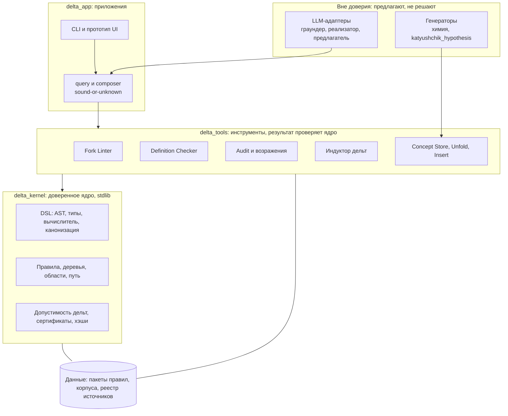
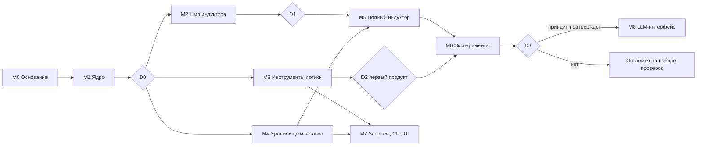

# План: Delta Engine — что это, чем будет и как строится

Версия 1.1, 27.10.2026 (добавлен трек E: эмпирическое получение функций-характеристик, раздел 9). Статус: план к утверждению.
Документ отвечает на три вопроса: **что мы строим и зачем**, **чем оно не является**, **в каком порядке и с какими проверками**. Детальные требования — в [спецификации](delta-engine-spec.md). Исходные материалы и их статус — в `data/sources/` (видео, форум, Telegram-чат).

---

## 0. Резюме

- **Что это.** Delta Engine — верифицируемый движок понятий. Знание хранится как деревья бинарных вилок (логических дельт) на объявленных областях определения. Движок: (1) проверяет вилки и определения; (2) относит объект к классу вместе с проверяемым путём и сертификатом; (3) открывает новые вилки по примерам (индуктор); (4) на всё, что не может доказать, отвечает `UNKNOWN`.
- **Чем не является.** Не языковая модель, не «физика с нуля», не доказательство теории автора. Генератор «функции-характеристики материи» в доступных нам материалах отсутствует (раздел 1.1, F1), поэтому в доверенное ядро он не входит.
- **Первый полезный результат** (конец этапа M3, примерно 3–5 недель): набор проверок для «логичного словаря» — Fork Linter, Definition Checker, Audit — с тестами на реальном корпусе (43 определения из монографии, вилки из форума и чата).
- **Исходная цель (LLM на дельтах)** сохранена как лестница из четырёх ступеней (раздел 2.5): движок → LLM-интерфейс → обучение LLM детерминированными проверками → эксперименты с бинарной головой. У каждой ступени есть проверяемая гипотеза и критерий остановки.
- **Генератор получаем опытным путём (трек E, раздел 9).** Посылка заказчика «пространство заполнено полем, уплотнённое поле — частица (элементарный заряд)» принимается как гипотеза H0. Лабораторных документов нет, поэтому её статус — `Hypothesis`. Проверка — компьютерные опыты на целочисленной модели поля с заранее зафиксированными критериями; результат относится к модели, а не к природе. Уточнения: «одноимённые отталкиваются» (K1) принято как констатация для электрических зарядов и служит условием модели; «притяжение работает за счёт экранирования» (H2) — гипотеза-механизм, проверяемая в модели.
- **Как строится.** Три слоя (ядро — инструменты — приложения) и адаптеры вне границы доверия; девять этапов M0–M8; четыре точки решения D0–D3; грубая оценка до M7 — 8–12 недель для одного разработчика (±50%).
- **От вас нужно:** ревью принимаемых дельт, решения в точках D1–D3, согласие на `git init` и новую структуру пакетов, ответы на вопросы раздела 8.

---

## 1. Анализ с учётом всех данных

### 1.1 Что установлено

| # | Факт | Основание | Надёжность |
|---|---|---|---|
| F1 | Генератор «функции-характеристики материи» в доступных материалах отсутствует | Монография: единственное упоминание — в списке литературы. Форум, тема 1734: раздел пуст, участник спрашивает, чем его заполнить. Чат: 0 упоминаний в 52 175 сообщениях. Видео At08288FuLQ (22:03–60:35): «мы не сделали базу данных», публикаций нет. Видео 2014 (05:46): «я не сказал, что это всё опубликовано» | Высокая для публичных материалов. Закрытые материалы автора не исключены. В списке литературы монографии числится статья «Комментарии о функциях-характеристиках материи» (Вестник Хакасского технического института, № 11, 2001); её текста у нас нет, поиск в сети её не находит |
| F2 | Единственное практическое применение метода — «дихотомическое деление понятий» для логичного словаря | Форум, тема 1708 (26 сообщений, 2023–2026). Чат: 26 сообщений о роде и видовом отличии | Высокая |
| F3 | Главный спор вокруг метода — «ложная дихотомия» | 36 сообщений в чате. Суть: пара именованных классов ≠ дополнение; антоним ≠ отрицание; признак неприменим к объекту | Высокая |
| F4 | Предикаты без параметров неоднозначны | Чат, 15.01.2024: «сохраняет форму» — за какое время и при какой нагрузке | Высокая |
| F5 | Вердикты LLM противоречивы и следуют формулировке запроса | Чат (67 сообщений о нейросетях), видео lC5swxhzw38 | Средняя (наблюдение, не эксперимент) |
| F6 | Таблица элементов слабо сжимается пороговыми вилками | Измерено (раздел 5): `group_block`, leave-one-out: 0,619 на (номер, масса) при 45 листьях полной подгонки на 118 элементов; 0,788 при вручную заданных «период, позиция» (31 лист); мажоритарный класс 0,322 | Высокая, воспроизводимо |
| F7 | Корпус для проверки определений существует | 43 термина из монографии с источником; цепочки вилок «поле / частицы / вещество», «объём / пространство / место», «количество / множество / величина» | Высокая |
| F8 | Среда | Python 3.11.9; 33 теста проходят; RTX 4070 SUPER 12 ГБ; 32 ГБ ОЗУ; torch и scikit-learn не установлены; каталог не под git | Проверено |

### 1.2 Что изменилось в понимании

| Раньше | Теперь | Следствие для плана |
|---|---|---|
| Цель — LLM на логических дельтах | Движок понятий и проверок; LLM — интерфейс и объект обучения, но не часть доверенного ядра | Первый этап без LLM; контракт LLM описан заранее |
| Знание = развёртка материи от поля до биологии | Развёртка требует генератора, которого нет; а деревья вилок классифицируют, но не порождают (1.3) | Классификатор плюс подключаемые генераторы |
| Генератор ждём от автора | Генератор получаем сами из опытов на модели, отталкиваясь от посылки H0 (заказчик, 27.10.2026) | Трек E (раздел 9) |
| Область: физика и химия | Область: общая классификация и логика. Практика сообщества — словарь | Первый продукт — набор проверок для определений и вилок |
| Дельта «безошибочна» | Безошибочен вывод по дереву. Выбор предикатов и данные — вне гарантии. Вилка корректна только относительно объявленной вселенной | Центр системы — формальная семантика вилок |
| Индуктор подтвердит принцип на таблице элементов | Измерено: пороговые вилки там слабы (F6) | Другие бенчмарки, производные признаки, честные ожидания |
| Один тип правил | Два типа: классифицирующие (дельты) и порождающие (генераторы) | Раздельные интерфейсы |
| Новизна — главный аргумент | Близкие подходы: экспертные системы, Пролог, индуктивное логическое программирование, описательные логики, деревья решений, формальный анализ понятий | Сравнение с базовыми методами; скромные заявления |
| LLM — помощник | LLM — непроверяемый источник кандидатов, вердикты противоречивы | Детерминированный арбитр на проверках |

### 1.3 Классифицировать и порождать — разные операции

- **Вилка классифицирует.** Получает готовый объект и возвращает класс. Пример: «непрерывная материя — поле».
- **Генератор порождает.** Создаёт объекты и состояния: элементы из запаса частиц, соединения по рецептам, шаги развёртки.
- Схема автора «пирамида» смешивает эти две вещи: «дерево деления материи» — классификация, «развёртка» — порождение.
- Измерение F6 показывает на практике: пороги на номере элемента не воспроизводят таблицу, потому что периодичность возникает из процесса (заполнение оболочек), а не из границ. Это процесс, то есть генератор.
- **Решение:** ядро только классифицирует и проверяет. Порождающие правила подключаются через интерфейс `Generator.propose(state) → кандидаты`, а каждый кандидат классифицируется и проверяется дельтами. Существующие `chemistry.py` и `compound_space.py` уже работают по этой схеме и станут первым плагином.

### 1.4 Честная оценка идеи

**Сильные стороны**

- Формальная семантика вилок с областью определения закрывает реальный спор сообщества (F3).
- Тотальность, исключительность и завершаемость гарантируются конструкцией DSL, а не уверением.
- Воспроизводимость и происхождение: хэши, версии правил, реестр источников.
- Есть корпус, есть пользователи (проект словаря), есть готовые тестовые кейсы.
- Детерминированный арбитр там, где вердикты LLM расходятся.

**Слабые стороны**

- Новизна скромная (прецеденты в 1.2).
- Заземление (как реальные данные превращаются в значения предикатов) не решено; в v1 исключено.
- Онтологии пишутся трудоёмко (урок экспертных систем).
- Пороговые вилки слабо сжимают сложные данные (F6).
- Генератора автора нет.

**Вердикт.** Реалистичный продукт — верифицируемый движок классификации и определений с набором проверок. «ИИ» в смысле автора — гипотеза, которую проверяют экспериментами, а не исходное допущение.

---

## 2. Чем это будет являться

### 2.1 Определение

> **Delta Engine** — верифицируемый движок понятий. Он хранит знание как деревья бинарных вилок на объявленных областях, проверяет вилки и определения, вычисляет класс объекта вместе с путём и сертификатом, открывает новые вилки по примерам и честно отвечает `UNKNOWN`, когда доказательства нет.

### 2.2 Три роли

1. **Ядро знаний.** Правила, деревья, области определения, источники, версии.
2. **Набор проверок.** Fork Linter, Definition Checker, Audit, структурированные возражения.
3. **Верификатор для LLM** (с M8). Детерминированные проверки как фильтр и источник сигнала для моделей.

### 2.3 Сценарии

| # | Сценарий | Вход → выход | Приёмка |
|---|---|---|---|
| UC1 | Проверка вилки | `(A, B, вселенная)` → `valid` / `invalid` + контрпример | E5 |
| UC2 | Проверка определения | термин, род, отличия → ошибки и предупреждения D1–D7 | E6 |
| UC3 | Классификация объекта | факты → лист, путь, сертификат либо `UNKNOWN` | N-тесты |
| UC4 | Построение таксономии | новое понятие → путь, ближайший род, отличие | E7 |
| UC5 | Индукция вилок | примеры → кандидаты дельт, ворота приёмки, ревью | E1–E4, E8 |
| UC6 | Аудит теорий по вилкам | теории, вилки, вердикты → оставшиеся и отброшенные с причинами | E6 |
| UC7 | Вопрос на русском (позже) | текст → формальный запрос → ответ с якорями | M8 |

### 2.4 Чем не является

- Не языковая модель и не замена LLM.
- Не симулятор физики и химии «из первых принципов».
- Не система с «самоидентификацией»: у термина нет измеримого определения ни в одном источнике.
- Не подтверждение или опровержение теории автора. Положения Катющика живут в изолированном пакете `katyushchik_hypothesis` со статусом `Hypothesis` и не могут быть основанием статуса `Proven`.

### 2.5 Путь к исходной цели: LLM на логических дельтах

| Ступень | Что | Проверяемая гипотеза | Критерий остановки |
|---|---|---|---|
| A (M0–M7) | Движок без LLM | Детерминированный движок с областью определения и сертификатами корректно решает проверки вилок, определений и классификации там, где вердикты LLM и споры расходятся | E5, E6 и метрики строгого профиля не выполнены |
| B (M8) | LLM-интерфейс: текст ↔ формальный запрос | Модель с проверкой по схеме превращает русские запросы в формальные, не создавая ложных `verified` | Хотя бы один ложный `verified` на тестовом наборе: LLM лишается доступа к контуру `verified` |
| C (исследование) | Обучение небольшой LLM на синтетике из движка с наградой от проверок | Модель делает меньше ошибок в вилках и определениях на отложенном наборе, чем исходная | Нет улучшения на заранее заданную величину (например, 10 п. п. абсолютной точности) |
| D (блю-скай) | Декодирование, ограниченное движком; бинарная выходная голова | Не формулируется до итогов C | Не начинается, если C не показала пользы |

Железо (RTX 4070 SUPER, 12 ГБ) позволяет дообучать небольшие модели (до нескольких млрд параметров в 4-битном режиме) на пределе; конкретная модель выбирается на M8.

---

## 3. Как строится

### 3.1 Решения по построению

| № | Решение | Почему |
|---|---|---|
| 1 | Доверенное ядро — отдельный пакет `delta_kernel`, только стандартная библиотека | Малая поверхность доверия; существующий `logical_delta_matter` смешивает симуляции с логикой |
| 2 | Предикат — данные (AST в JSON) плюс текстовая форма; без `eval` | Безопасность, сериализация, стабильные хэши |
| 3 | Вычисление даёт три исхода: `true`, `false`, `OUT_OF_DOMAIN` | Решает спор о применимости признака (F3) без третьего значения истины |
| 4 | Только точная арифметика: `int`, `Fraction`; `mod` и `div` на литерал разрешены | Нет `float` в доверенном пути; периодические признаки выразимы |
| 5 | Производные атрибуты и таблицы значений — часть схемы, вычисляются в порядке без циклов | F6: без признаков-производных индукция слаба |
| 6 | Индуктор только предлагает; приём кандидатов через ворота G1–G7 и ревью | Обучение — не источник истины |
| 7 | Хранилище понятий многофасетное; развёртка ленивая, кэш по `(версия правил, запрос)` | Объёмы понятий пересекаются (S-15); не «вычислить всё, потом удалить лишнее» |
| 8 | LLM вне доверенного пути; контракт задан заранее | F5 |
| 9 | Детерминизм: фиксированный порядок, канонический JSON, хэш ответа | Воспроизводимость, тест N8 |
| 10 | Каждое утверждение и правило ссылается на источник со статусом | Реестр источников расширяется полями `status`, `anchor` |

### 3.2 Архитектура и граница доверия



**Правило границы доверия.** Статус `verified` выдаётся только при наличии сертификата ядра. Инструменты и приложения не могут выдать его сами; адаптеры вне доверия могут только предлагать входные данные и кандидатов.

### 3.3 Структура репозитория (целевая)

```
delta_kernel/            # только стандартная библиотека
  types.py  dsl.py  canonical.py  rules.py  evaluate.py  verify.py  certificate.py
delta_tools/
  fork_lint.py  definition_check.py  audit.py
  induction/             # кандидаты, критерий, ворота, карантин, признаки
  taxonomy/              # concept_store, unfold, insert
delta_app/
  query.py  composer.py  cli.py  ui/ (позже)
adapters/                # вне доверия
  llm/ (M8)   generators/ (chemistry, katyushchik_hypothesis)
logical_delta_matter/    # существующий прототип остаётся; мост к ядру
data/
  rule-packs/  corpora/  sources/
tests/  kernel/  tools/  app/  corpora/  property/
docs/
```

Существующий код: `delta_core.py` заменяется ядром (мост читает `data/matter-deltas.json`); `formal_domains.py` переезжает в пакет правил; `proof_engine.py` даёт имена статусов; `source_registry.py` расширяется; `chemistry.py` и `compound_space.py` становятся первым генератором; `katyushchik_cuda_galaxy/` остаётся отдельной исследовательской песочницей, не частью движка.

### 3.4 Технологии

Python 3.11; ядро — без зависимостей; тесты — pytest (property-тесты на собственных генераторах случайных данных или hypothesis, если установим); z3 — опционально; CLI — argparse; прототип интерфейса — статическая страница с JSON-обменом (по образцу веб-приложения участников) или существующий Streamlit; LLM — на M8, API или локальная модель, решение там.

### 3.5 Данные

| Набор | Состояние | Действие |
|---|---|---|
| Материя: дерево, 118 элементов, 82 соединения | Есть | Использовать в E1–E4 |
| Формальные домены (материя, дискретность, плоскости) | Есть | Перенести в пакеты правил |
| 43 определения из монографии | Есть (форум, тема 406) | Разобрать в `corpora/definitions.json` с источником |
| Цепочки вилок форума (схемы, определения Аристотеля и словарей) | Текст есть, картинки не скачаны | Выделить кейсы, при необходимости попросить схемы |
| Кейсы чата («ложная дихотомия» и др.) | В `ChatExport_2026-10-27` | Выписать обезличенные кейсы в `corpora/fork_cases.json` |
| Транскрипты видео | Есть | Только как источники требований |
| PDF «бесконечность.pdf» (форматирование пространства, 2012) | Прислан в сообщении, в папке проекта нет; содержание повторяет раздел «Форматирование трёхмерного пространства» монографии | Положить в `data/sources/`, зарегистрировать |
| Лабораторные эксперименты пользователя (посылка H0, раздел 9) | Протоколы и данные не предоставлены | Запросить (вопросы раздела 9.6) |
| Внешние бенчмарки (UCI Zoo, Mushroom) | Нет | Скачать при согласии; проверить лицензию |
| Синтетические иерархии для E7 | Нет | Генерировать |

**Конфиденциальность.** Экспорт чата содержит имена и никнеймы частных лиц; в репозитории хранится только манифест и обезличенные кейсы. Папку `ChatExport_2026-10-27` не публиковать. Тексты форума — исследовательские копии, не для распространения.

### 3.6 Качество

- **Пирамида тестов:** модульные; свойства (тотальность и детерминизм DSL на случайных выражениях и записях, круговая сериализация); эталонные на корпусах; мутационные для определений и вилок; регрессия 33 существующих тестов; замер числа вызовов предикатов при вставке.
- **Определение готовности (DoD):** тесты зелёные; запись в таблице трассировки; хэши стабильны; нет `float` в ядре; документация обновлена; для экспериментов критерии записаны до запуска.
- **Процесс:** сначала спецификация и критерии, затем тест, затем код; отрицательные результаты попадают в отчёт; на точках решения фиксируется протокол.
- **`git init` и `.gitignore`** (в том числе `ChatExport_*`, `runs/`, `__pycache__`) — задача M0.

### 3.7 Трассировка: источники → модули → проверки

| Источник | Модуль | Проверка |
|---|---|---|
| S-1 вилка A / не-A | `delta_kernel.rules` | тесты ядра, E1 |
| S-3 ленивая развёртка | `taxonomy.unfold` | N8, E7 |
| S-4, S-15 общая структура, пересечение объёмов | `concept_store` (фасеты) | тест фасетов, E6 |
| S-5 суженное множество | области, `OUT_OF_DOMAIN` | N3 |
| S-7 калибровка по данным | эксперименты | E2, E3 |
| S-8, S-13 законы логики, формат критики | `fork_lint`, `audit`, `object` | E5, E6 |
| S-9, S-10, S-14 определения | `definition_check` | E6 |
| S-11 констатация и теория | классы знания | тест «`Hypothesis` не основание `Proven`» |
| S-12 отсев вилками | `audit` | E6 |
| S-16, S-17 практика словаря, масштабирование | `taxonomy.insert` | E7 |
| S-18 ложная дихотомия | `fork_lint` | E5 |
| S-19 операциональность | `dsl` (параметры предикатов) | N5-подобные тесты |
| S-2, S-6 пирамида, три компонента | схема архитектуры (гипотезы, не требования) | документация |

---

## 4. План разработки

### 4.1 Этапы

Оценка в человеко-днях грубая (±50%), для одного разработчика. Работа с ассистентом ускоряет написание кода, но не ревью, не сбор данных и не принятие решений.

| Этап | Содержание | Результат | Приёмка | Объём |
|---|---|---|---|---|
| **M0 Основание** | `git init`, скелет пакетов, JSON-схемы (`schema`, `delta-rule@0.2`, `delta-query@0.1`, результат, источник), расширение реестра (`status`, `anchor`), корпуса кейсов | Репозиторий с проверяемыми схемами и корпусами | Схемы валидируют примеры; 33 теста зелёные; N9 | 2–3 дня |
| **M1 Ядро** | DSL (AST, парсер, типизация, вычислитель, каноническая форма), производные атрибуты, `mod` и `div` на литерал, таблицы значений, правила, деревья, путь, `OUT_OF_DOMAIN`, статическая проверка тотальности, сертификаты, хэши, мост к `matter-deltas.json` | `delta_kernel` | N3, N4, N5, N8; свойства тотальности и детерминизма на ≥ 10⁵ случайных случаев; мост даёт те же классификации, что `classify_delta` | 6–8 дней |
| **M2 Шип индуктора** | Жадный индуктор (равенство, порог, конъюнкции до 2), без ворот ревью; бейзлайн-замеры | Отчёт «ранний сигнал» | E1; числа по элементам записаны (раздел 5) | 3–5 дней |
| **M3 Инструменты логики** | Fork Linter, Definition Checker (D1–D7), Audit, возражения, пакет `logic_core` | Первый продукт: набор проверок словаря | E5, E6 | 7–10 дней |
| **M4 Хранилище и вставка** | Фасеты, ленивая развёртка, кэш, вставка спуском по вилкам | `delta_tools.taxonomy` | N7, N8, E7 | 5–7 дней |
| **M5 Полный индуктор** | Ворота G1–G7, карантин, инкрементальность, признаки-производные (в том числе продвижение порогов в «корзины»), критерий MDL | `delta_tools.induction` | N6; E2–E4 запускаются | 8–12 дней |
| **M6 Эксперименты и отчёт** | E1–E8 по протоколу, сравнение с базовыми алгоритмами | `docs/report-v1.md` | Критерии раздела 5 | 4–6 дней |
| **M7 Запросы, CLI, прототип UI** | `delta-query@0.1`, composer, CLI, прототип интерфейса для вилок и определений, экспорт DOT и JSON | `delta_app` | Метрики строгого профиля | 6–8 дней |
| **M8 LLM-интерфейс** (после D3) | Контракт из спецификации, граундер и реализатор, затем ступень C | `adapters/llm` | Метрики раздела 14 спецификации | 8–15 дней |

Итого до M7: 41–59 человеко-дней, то есть 8–12 недель.



**Критический путь:** M0 → M1 → M3 (первый продукт через 3–5 недель). M2 стартует сразу после M1 и даёт ранний сигнал, пока идёт M3. Трек E (раздел 9) идёт параллельно M2–M5: E0 и E1 можно начать после M0, потому что симулятор не входит в доверенное ядро.

### 4.2 Точки решения и критерии остановки

| Точка | Когда | Вопрос | Критерий «вперёд» | Если нет |
|---|---|---|---|---|
| D0 | после M1 | Ядро годится? | Свойства и N-тесты зелёные | Доработка ядра, без смены курса |
| D1 | после M2 | Свой индуктор оправдан? | E1: воспроизводит дерево материи; числа по элементам не хуже бейзлайна F6 | Заменить свой поиск готовым алгоритмом (ID3/C4.5-подобным) внутри, оставив наши ворота и сертификаты |
| D2 | после M3 | Инструменты полезны? | E5 и E6 пройдены; вердикты Linter согласуются с независимой разметкой ≥ 90% на 30 вилках (если будут разметчики) | Пересмотр формальной семантики вилок |
| D3 | после M6 | Принцип подтверждён? | (а) по E2 и E8 результат не хуже бейзлайна при не большем числе листьев на ≥ 2 из 3 наборов; (б) по E4 сжатие ≥ 3 : 1 хотя бы на одном наборе; (в) 100% предсказаний с сертификатами | Продолжаем как набор проверок; M8 сводится к интерфейсу без ступени C; тезис «компактный генератор» помечается неподтверждённым |
| D4 | после E4 | Реализуемы ли посылки H0 и H2 в модели? | Критерии 9.5–9.6: тест существования пройден, K1 соблюдено, C1–C3 и C6 выполнены в одном семействе моделей при сходимости по решётке; C4 и C5 фиксируются в любом случае | Результат записывается как отрицательный для проверенных семейств; решение о других семействах принимает заказчик |

Наружу (участникам проекта словаря) показывать результаты и просить разметку — только с вашего согласия.

### 4.3 Календарь (ориентир)

| Недели | Работа |
|---|---|
| 1 | M0, начало M1 |
| 2 | M1, D0 |
| 3 | M2 (D1), начало M3 |
| 3–5 | M3, D2: первый продукт |
| 5–6 | M4 |
| 6–8 | M5 |
| 8–9 | M6, D3 |
| 9–11 | M7 |
| после D3 | M8 |

### 4.4 Первые десять задач

1. `git init`, `.gitignore`, первый снимок (после вашего согласия).
2. Скелет `delta_kernel`, `delta_tools`, `delta_app`, каталоги тестов, конфиг pytest.
3. JSON-схемы: схема данных `Σ`, `delta-rule@0.2`, `delta-query@0.1`, результат, источник.
4. Реестр источников: поля `status`, `anchor`; регистрация транскриптов, тем форума, манифеста чата.
5. Корпуса: `fork_cases.json` (≥ 30 кейсов с ожидаемым вердиктом и источником), `definitions.json` (43 + мутации), `theories_audit.json`.
6. DSL: токенизатор, парсер, AST, каноническая форма, типы.
7. Вычислитель с `OUT_OF_DOMAIN` и бюджетом.
8. Дерево: компиляция, проверка допустимости, путь, сертификат; мост к `matter-deltas.json`.
9. Property-тесты: тотальность, детерминизм, круговая сериализация.
10. Перенос замера из раздела 5 в `scripts/baseline_elements.py` с фиксацией чисел.

---

## 5. Эксперименты

Критерии записаны до запуска. Различаем **верификацию** (работает ли реализация), **валидацию** (полезен ли результат на реальных данных) и **проверку инструмента** (совпадает ли вердикт с эталоном).

### 5.1 Замеренные бейзлайны (27.10.2026)

Жадное дерево на чистом Python (критерий Джини на `Fraction`, пороги — середины между соседними значениями), 118 элементов из `data/confirmed-concepts.json`, перекрёстная проверка с исключением по одному.

| Задача и признаки | Листьев при полной подгонке | Точность (leave-one-out) |
|---|---|---|
| `group_block`, (номер, масса) | 45 | 0,619 |
| `group_block`, только номер | — | 0,619 |
| `group_block`, глубина ≤ 3 или ≤ 8 | — | 0,619; глубина 5 — 0,593 |
| `group_block`, вручную введённые «период, позиция в периоде» | 31 | 0,788 |
| `group_block`, мажоритарный класс (переходные металлы) | — | 0,322 |
| `standard_state`, (номер, масса) | 17 | 0,864 (мажоритарный класс «твёрдое» даёт 96/118 = 0,81) |

Выводы: пороговые вилки на сырых признаках дают около 62% при 45 листьях на 118 строк (сжатие слабое); границы периодов (2, 10, 18, 36, 54, 86) — это подсказка, которую индуктор должен находить сам (раздел «Признаки»); `standard_state` — неинформативная цель.

### 5.2 Набор экспериментов

| ID | Тип | Данные | Измеряем | Критерий | Честное ожидание |
|---|---|---|---|---|---|
| E1 | Верификация | Синтетика по дереву материи | Эквивалентность дерева; число примеров до сходимости | Полная эквивалентность | Выполнится. Это тест корректности индуктора, а не доказательство принципа |
| E2 | Валидация | 118 элементов, `group_block` | Точность LOO; число листьев | Сырые признаки: не хуже 0,619 при ≤ 45 листьях. С автоматически построенными признаками: ≥ 0,75. У каждого листа сертификат | Сырые признаки ≈ бейзлайн (тот же класс моделей). Рост даст только построение признаков, гарантий нет |
| E3 | Валидация | Те же данные, перенос на подвыборку | Доля верных и доля `UNKNOWN` на отложенных | `UNKNOWN` вместо ошибки там, где правил нет | Зависит от E2 |
| E4 | Эффективность | E1–E3 | Правил к строкам таблицы | Без порога; результат фиксируется | На элементах слабое сжатие (около 2,6 : 1). Ожидаемый отрицательный результат по тезису «компактный генератор» для вилок |
| E5 | Проверка инструмента | ≥ 30 вилок из видео, форума, чата | Совпадение вердикта с эталоном | 100% на эталоне; ≥ 90% согласия с независимыми разметчиками (если есть) | Выполнимо |
| E6 | Проверка инструмента | 43 определения, мутации, 10 теорий × 4 вилки | Совпадение вердиктов; аудит не трогает теории без положения | 100% на эталонной разметке | Выполнимо |
| E7 | Масштаб | Синтетические иерархии 10², 10³, 10⁴ понятий | Число вызовов предикатов на вставку | Рост заметно медленнее линейного | Выполнимо |
| E8 | Валидация | UCI Zoo, Mushroom (если разрешат лицензия и сеть) | Точность, листья, объяснимость | Не хуже дерева решений при 100% сертификатов | Точность в районе бейзлайна; ценность — гарантии и `UNKNOWN`, а не точность |

**Что именно утверждаем.** Преимущество движка — не точность по сравнению с градиентным бустингом, а гарантии (тотальность, исключительность, происхождение), дисциплина `UNKNOWN` и объяснимость. Это измеряется метриками строгого профиля: `SoundnessRate`, `ProofCoverage`, `UnknownDiscipline`, `GroundingPrecision`.

---

## 6. Риски и меры

| # | Риск | Мера |
|---|---|---|
| R1 | Ценность неочевидна, новизна скромная | Точки D2 и D3; позиционирование как набора проверок; сравнение с базовыми методами |
| R2 | Заземление не решено | Вне v1; контракт M8; формальные входы |
| R3 | Выразительность DSL против тотальности | Производные атрибуты, таблицы, `mod` и `div`; расширения только с доказательством тотальности |
| R4 | Трудоёмкость онтологий | Инструменты вставки и аудита; корпус сообщества; индуктор |
| R5 | Подгонка индуктора | Перекрёстная проверка; ворота G5; карантин противоречий |
| R6 | Споры об интерпретации вилок | Единая формальная семантика (область + дополнение), тесты E5 |
| R7 | Репутационный: проект могут принять за подтверждение теории автора | Нейтральные формулировки; пакет гипотез изолирован; в отчётах нет оценок физики |
| R8 | Приватность и права на данные | Чат вне репозитория; обезличенные кейсы; форум — только исследовательские копии; лицензии внешних наборов |
| R9 | Разрастание объёма | Минимум = M0–M3; всё остальное за точками решения |
| R10 | Среда: нет git, нет torch, Windows | `git init`; ядро на stdlib; torch ставится только на M8 |
| R11 | Закрытые материалы автора могут изменить картину | Генератор подключается как `katyushchik_hypothesis` и проходит E3, архитектура не меняется |
| R12 | Результаты опытов на модели примут за подтверждение физики или лабораторных утверждений | Поле `scope = model`; запрет повышать статус H0 по итогам модели; формулировки отчётов |
| R13 | Наивная модель не даёт устойчивых частиц (теорема Деррика для скалярного поля) | Шип E1 сравнивает три семейства моделей; тест существования до дорогих кампаний |
| R14 | Подгонка модели под калибровочные цели | Предрегистрация, правило подсчёта параметров, предсказание вне калибровки |
| R15 | Известные дефекты моделей давления (насыщение, сопротивление, нагрев) проявятся и в модели H2 | Явные тесты C5 и C6; отрицательный результат записывается как результат |
| R16 | Констатацию K1 могут прочитать шире её области (как факт для тяготения) | Область применения `domain` записана в реестре; обобщение — отдельная гипотеза H1 |

---

## 7. Вне области и позже

- Физическое моделирование (галактика, CUDA) — отдельная песочница.
- Генератор автора и пакет `katyushchik_hypothesis` — после получения материалов; собственный генератор получаем в треке E (раздел 9).
- «Персонификация» и «самоидентификация» — после появления измеримого определения.
- Свободная генерация текста, бинарная выходная голова — ступень D.
- Публичный сервис и привлечение сообщества — по вашему решению.

---

## 8. Роли, решения, открытые вопросы

**Что нужно от вас**

- Ревью принимаемых дельт (ворота G7) на тестовых наборах.
- Решения в точках D1, D2, D3.
- Материалы: любые новые источники, определения, которым вы доверяете, схемы вилок (картинки не вошли в экспорт).
- Согласие на действия, затрагивающие внешний мир: показ результатов сообществу, публикация.

**Открытые вопросы**

1. **Название.** Рабочее «Delta Engine»; альтернатива — «Логичный словарь» (по сути первого продукта).
2. **`git init`** в корне проекта и фиксация текущего состояния — согласны?
3. **Новые пакеты** `delta_kernel`, `delta_tools`, `delta_app` рядом с `logical_delta_matter` (рекомендую) или внутри него?
4. **Интернет** для скачивания внешних наборов (E8): разрешено?
5. **Внешняя разметка** 30 вилок независимыми людьми для D2: есть ли кому показать?
6. **Лицензия** будущего кода и данных.
7. **Определения модели** (9.3) и цели калибровки (9.6): приняты в принципе; нужно финальное утверждение на E0, включая область K1 (электрический заряд) и формулировку H2.
8. **Статьи автора** 2001 и 2003 годов (9.8): есть ли у вас тексты?

---

## 9. Трек E: эмпирическое получение функций-характеристик

### 9.1 Постановка

Предложение заказчика (27.10.2026): получить «функции-характеристики материи» **опытным путём, прогоняя тесты**, отталкиваясь от посылки H0:

- P1: пространство заполнено полем;
- P2: уплотнённое поле — частица (элементарный заряд).

Уточнения заказчика того же дня:

- K1: «одноимённые отталкиваются» — принимается как констатация;
- H2: «притяжение работает за счёт экранирования» — механизм притяжения.

Решения заказчика: «тесты» — компьютерные опыты на модели; материалов лаборатории нет, есть только выводы; определения поля и уплотнения — вариант ассистента (9.3); цели калибровки — знаки взаимодействия, квантованный заряд, закон расстояния, отношение масс.

**Статус посылки H0.** `Hypothesis`: лаборатория заказчика, только выводы, документов нет. Это то же правило, что применяется к положениям автора (S-11): без протокола, данных и воспроизводимости утверждение не становится `Constatation`. Если протоколы и данные появятся, P1 и P2 можно перевести по отдельности. Компьютерные опыты статус не повышают: модель показывает, что возможно в модели, а не что верно в природе (`scope = model`).

**Статус K1.** Для электрических зарядов это констатация в обычном смысле: знак силы между одноимёнными зарядами — базовый результат электростатики (закон Кулона), а показатель обратных квадратов проверен с очень высокой точностью (Плимптон—Лотон, 1936; Уильямс—Фаллер—Хилл, 1971, Phys. Rev. Lett. 26, 721; числа взяты из вторичных материалов, оригиналы я не читал). Поэтому K1 записывается как `Constatation`, `scope = empirical`, `domain = электрический заряд`. Обобщение «у всех фундаментальных взаимодействий одноимённые отталкиваются», включая тяготение, в запись не входит: в стандартной физике одноимённые массы притягиваются, параллельные токи притягиваются. Обобщение остаётся гипотезой H1 и следует из H2, если тяготение действительно сводится к экранированию. Результаты опытов на модели статус K1 не меняют ни в какую сторону.

**Как K1 используется.** Как условие модели. «Одноимённые» — частицы с одним знаком заряда Q (9.3). Семейство, в котором одноимённые частицы не отталкиваются, отклоняется как несовместимое с констатацией; оно остаётся в кампании как отрицательный контроль.

**Статус H2.** `Hypothesis`: тело экранирует часть отталкивающего воздействия поля, и результирующая сила направлена к телу. Это тот же класс идей, что модели давления Фатио—Лесажа, поэтому известные возражения проверяются прямо в модели:

- тень определяется сечением тела, а не массой; ответ Лесажа — материя в основном пустая и потому частично прозрачна, но у крупных тел возможно насыщение, и сила перестаёт быть пропорциональной массе (подтверждено открытыми описаниями в этой сессии) — проверяется в C5;
- сопротивление движению тела в изотропном потоке и нагрев поглощающих тел (по моим знаниям; в этой сессии поиском не подтверждено) — проверяется в C6.

Автор монографии подчёркивает отличие своей версии от модели Лесажа: прямое отталкивание тел без среды-посредника. В данном проекте поле — среда по посылке P1, поэтому различие не освобождает от проверок C5 и C6.

### 9.2 Что считается функцией-характеристикой операционально

Функция-характеристика — **отображение из параметров модели и начальных условий в класс устойчивых образований и их инварианты**:

`χ: (θ, начальное поле) → {класс, заряд, масса, размер, подвижность, поведение при взаимодействии}`

Опыты дают таблицу прогонов. Индуктор (M5) открывает по ней вилки: при каких θ существуют устойчивые образования, какие классы различимы, чем они различаются. Результат — пакет правил `field_model@…` со статусом `Hypothesis` и `scope = model`.

Это узкое операциональное определение. Оно не равно понятию автора («блок информации о формировании вещественной материи»), которое в доступных материалах не определено; соответствие понятию автора оценивает только заказчик.

### 9.3 Модель первого опыта (вариант ассистента, к утверждению на E0)

Определения даны в форме «род + отличие» и будут проверены Definition Checker (D1–D7), как только он появится.

| Термин | Род | Видовое отличие | Проверяемый предикат |
|---|---|---|---|
| Решётка | конечное множество ячеек | куб n × n × n с периодическими границами | `n` задан |
| Поле | функция на решётке | целочисленное значение φ в каждой ячейке | значения типа `Int` |
| Фон | значение поля | однородное решение правила, φ₀ | `φ(x) == φ0` для всех `x` |
| Правило | локальное отображение поля | меняет φ только обменом между соседними ячейками (сохраняет сумму φ) | `sum(φ') == sum(φ)` |
| Уплотнение | связная область | отклонение `abs(φ − φ₀) > θ` во всех её ячейках, знак отклонения постоянен | компонента связности порога |
| Частица | уплотнение | сохраняет размер и заряд в пределах допуска не менее T шагов и не распадается | `persist(T, tol)` |
| Заряд | сохраняющаяся величина частицы | Q = сумма (φ − φ₀) по её области | `Int` |
| Масса | характеристика частицы | M = сумма `abs(φ − φ₀)` по её области (вариант: энергия правила) | `Int` |
| Одноимённые частицы | пара частиц | заряды Q₁ и Q₂ одного знака | `sign(Q1) == sign(Q2)` |
| Отталкивание | взаимодействие пары | положительное относительное ускорение: расстояние между центрами растёт быстрее, чем при отсутствии взаимодействия | `rel_acc > 0` |
| Притяжение | взаимодействие пары | отрицательное относительное ускорение | `rel_acc < 0` |
| Поток воздействия | величина поля | суммарный импульс, переданный полем через площадку за шаг | `Int` |
| Экранирование | свойство тела | поток воздействия на заданный объект при теле между объектом и источником меньше, чем без тела | `flux_with < flux_without` |
| Прозрачность | свойство тела | отношение потока через тело к потоку без тела | `Rat` |

Параметры (θ, T, tol, n, правило) входят в описание опыта и фиксируются до запуска. Знак заряда возникает как знак отклонения от фона, поэтому оба знака присутствуют в модели с самого начала.

**Ограничение, без которого H2 проверялась бы не тем:** правило модели не содержит прямого притягивающего члена. Притяжение может появиться только как следствие экранирования. Отталкивание одноимённых (K1) задаётся как часть правила.

### 9.4 Ограничения из известной теории: что учесть заранее

Чтобы не строить заведомо бесплодную модель, в дизайн внесены известные результаты (по моим знаниям; проверяются на шипе E1):

- Для **одного вещественного скалярного поля** со стандартной энергией в трёх пространственных измерениях статических устойчивых локализованных решений нет (теорема Деррика). Нужен механизм стабилизации.
- Известные механизмы: (а) дискретность решётки, закрепляющая структуры; (б) конкуренция короткодействующего притяжения и дальнодействующего отталкивания (модели типа Охта—Кавасаки; аналог капельной модели ядра с кулоновским членом); (в) топологический заряд у многокомпонентного поля (модель Скирма, хопфионы); (г) сохраняющийся заряд с вращением фазы (Q-шары, комплексное поле).
- Простая диффузионная динамика с сохранением (типа Кана—Хиллиарда) приводит к слиянию одноимённых областей, то есть нарушает K1, и к взаимному уничтожению разноимённых.
- Прямое притяжение запрещено условием H2, поэтому конкуренция «притяжение против отталкивания» из пункта (б) допустима только в форме «отталкивание против экранирования».

На шипе E1 сравниваются **четыре семейства моделей** с общей оболочкой определений 9.3:

1. **A. Решёточное правило с порогами** (типа «осыпания»): детерминированное, целочисленное, закрепление на решётке. Ожидается нарушение K1: **отрицательный контроль**.
2. **B. Сохраняющая динамика типа Кана—Хиллиарда** с целочисленной дискретизацией. Ожидается нарушение K1: **отрицательный контроль** и эталон.
3. **C. Отталкивание с дальнодействующим ядром:** K1 задан членом правила (ядро в виде таблицы целых весов); стабилизация частицы за счёт конкуренции с короткодействующим членом без притяжения.
4. **D. Поток и экранирование** (реализует H2): решёточный газ носителей воздействия (целочисленный, типа HPP или FHP, с точным учётом импульса); тела поглощают или отражают носителей; сила на тело — сумма переданного импульса. Одноимённые частицы действуют на носителей так, что отталкиваются (K1); все тела экранируют.

Допуск семейства к кампаниям — **тест существования** (в серии запусков найдены частицы по определению 9.3, живущие не менее T шагов при сохранении Q) и **проверка K1** (отрицательные контроли обязаны её провалить, иначе проверка нечувствительна).

### 9.5 Протокол кампании

- **Предрегистрация.** До запуска фиксируются определения, пороги, цели K1 и C1–C6 и критерии. Файл протокола хэшируется и регистрируется.
- **Воспроизводимость.** Целочисленная арифметика; случайность только через заданное зерно; для каждого прогона записываются хэш конфигурации, версия кода, зерно и итог.
- **Таблица прогонов** (`delta-experiment@0.1`): параметры θ, начальные условия, наблюдаемые (число частиц, их Q, M, размер, время жизни, переданный импульс), вердикты. Это вход индуктора.
- **Сходимость по решётке.** Эффект относится к модели только если сохраняется при измельчении решётки (удвоение сетки с пересчётом параметров). Иначе это артефакт дискретизации.
- **Подсчёт параметров.** Число свободных параметров должно быть меньше числа независимо воспроизведённых наблюдаемых; иначе соответствие не считается подтверждением.
- **Предсказание вне калибровки.** Минимум одна наблюдаемая, не использованная при подборе параметров.
- **Отрицательные контроли и негативные результаты** записываются так же, как позитивные.

### 9.6 Условие модели и цели калибровки

| ID | Цель | Критерий (фиксируется до запуска) | Честное ожидание |
|---|---|---|---|
| K1 | Условие модели: одноимённые частицы отталкиваются | Для любой пары одноимённых частиц относительное ускорение положительно при всех проверенных расстояниях и ориентациях, не менее N конфигураций | Нарушается в A и B (отрицательные контроли); в C задан правилом; в D зависит от реализации |
| C1 | Разноимённые частицы притягиваются как следствие экранирования (по H2), без прямого притягивающего члена | Относительное ускорение отрицательно при всех проверенных расстояниях и ориентациях, не менее N конфигураций; сила меняется вместе с прозрачностью тел | Возможно только в D |
| C2 | Квантованный заряд | Существует минимальный устойчивый заряд (элементарный); составные частицы несут его целые кратные; устойчивых частиц с нецелым отношением к единице нет | Сильно зависит от семейства |
| C3 | Закон расстояния для отталкивания (K1) и для экранирующего притяжения (C1) | Показатель α в диапазоне расстояний не уже порядка в пределах допуска ±0,2 от 2 (три измерения) либо отчёт, что размера решётки недостаточно | Ограничено размером решётки |
| C4 | Отношение масс двух устойчивых классов | Близко к 1836,15 без подгонки при соблюдении правила подсчёта параметров | Амбициозная цель; ожидаемо не выполнится; для D4 не обязательна |
| C5 | Экранирование и масса | Сила экранирующего притяжения пропорциональна массе M в диапазоне масс не уже порядка в пределах допуска; насыщение измеряется количественно | Известный недостаток моделей давления: возможно насыщение; результат фиксируется любой |
| C6 | Сопротивление и нагрев | Изолированное тело, движущееся через изотропный поток, получает тормозящий импульс не выше допуска, заданного на E0 из условия: время торможения на порядки больше периода обращения пробной пары; поглощённая энергия не растёт неограниченно | Известное возражение против моделей давления; в D вероятно проявится |

**Что означает результат.** Выполнение K1, C1–C3 и C6 в одном семействе показывает, что H0 и H2 реализуемы в модели с наблюдаемым поведением зарядов и без известных дефектов моделей давления. Это не подтверждает лабораторные утверждения, не доказывает тяготение через экранирование и не меняет статус H1, H2 и H0. Невыполнение во всех семействах — отрицательный результат для H0 и H2 *в этих семействах*, а не их опровержение вообще.

### 9.7 Этапы трека E

| Этап | Содержание | Результат | Приёмка | Объём |
|---|---|---|---|---|
| E0 | Утверждение определений 9.3, областей K1 и H2 и целей K1, C1–C6; допуски C3 и C6; протокол предрегистрации; схема `delta-experiment@0.1`; реестр гипотез | Документ протокола, схема | Определения и допуски утверждены заказчиком (и прошли Definition Checker, когда он готов) | 2–3 дня |
| E1 | Шип: семейства A, B, C, D; тест существования и проверка K1 | Генератор-плагин `field_lattice` (numpy или numba на CPU), отчёт «какие семейства допущены» | Тест существования хотя бы на одном семействе, отрицательные контроли провалили K1; иначе пересмотр модели | 6–10 дней |
| E2 | Двухчастичные опыты: знаки, закон расстояния, экранирование, сопротивление | Таблицы взаимодействий; оценки знака, показателя, пропорциональности массе, торможения | Результат по K1, C1, C3, C5, C6 (в любую сторону) | 5–7 дней |
| E3 | Статистическая кампания: спектр устойчивых классов | Таблица классов (Q, M, размер, время жизни) | Результат по C2 и C4 | 4–6 дней |
| E4 | Индукция характеристических функций и калибровка | Пакет `field_model@…` (`Hypothesis`, `scope = model`), отчёт | Критерии 9.5; точка D4 | 3–5 дней |

Итого 20–31 человеко-день. Трек идёт параллельно M2–M5: E0 и E1 можно начать сразу после M0, E4 требует индуктора из M5.

Существующий симулятор `world_exact.py` не подходит как есть: в нём первичны типизированные частицы, поля нет. Его части (детерминизм, хэш состояния, чекпоинты, обнаружение кластеров) используются повторно. Для решётки 32³–64³ достаточно CPU (numpy 2.3 и numba установлены); GPU пока не нужен (`numba.cuda` в этой среде недоступен).

### 9.8 Что нужно от вас

1. Подтвердить или исправить определения 9.3 и область K1 (электрический заряд; обобщение остаётся H1).
2. Подтвердить формулировку H2 и допуски C3 и C6 на этапе E0.
3. Протоколы и данные лабораторных опытов, если они появятся: тогда P1 и P2 можно будет по отдельности перевести из `Hypothesis` в `Constatation`.
4. Тексты статей автора: 2001 («Комментарии о функциях-характеристиках материи») и 2003 («Введение в энергетику безопорных схем движения», по сообщению на форуме содержит «полную схему образования волны и частицы»; в ней же, по цитате на форуме, речь об экранировании воздействия массой). С моей стороны сайт публикации недоступен, поиск статью 2001 года не находит.
5. Решение в точке D4.

---

## Приложение A. Расширения DSL по итогам анализа

| Элемент | Определение | Почему тотален |
|---|---|---|
| `a mod k`, `a div k` | Остаток и целая часть от деления `Int` на литерал `k ≠ 0` | Делитель — ненулевая константа |
| Производный атрибут `d := expr` | Вычисляется из базовых и ранее объявленных производных | Порядок без циклов; стоимость ограничена размером выражения |
| Таблица значений | Конечное отображение интервалов или ключей в значения с обязательным `default` | `default` покрывает любой ключ |
| Параметризованный предикат | `preserves_shape(load, duration, tolerance)` | Условия вынесены в аргументы (S-19) |

**Продвижение порогов в «корзины» (идея для M5).** Если индуктор находит пороги, которые разделяют повторяющийся класс (для благородных газов это 2, 10, 18, 36, 54, 86), он предлагает производные атрибуты `bucket(n)` и `offset(n) = n − начало_корзины(n)`. Вручную заданные «период, позиция» дают 0,788 против 0,619; задача индуктора — найти такой признак без подсказки. Результат не гарантирован и измеряется в E2.

---

## Приложение B. Реестр гипотез и констатаций

| ID | Формулировка | Класс | Область (`domain`), `scope` | Источник | Состояние | Что меняет статус | Проверка |
|---|---|---|---|---|---|---|---|
| K1 | Одноимённые электрические заряды отталкиваются | `Constatation` | электрический заряд; `empirical` | Решение заказчика 27.10.2026; закон Кулона и его проверки (якоря ниже) | Принято; применяется как условие модели | Не меняется результатами модели | K1 в 9.6 (согласованность модели) |
| H0.P1 | Пространство заполнено полем | `Hypothesis` | `empirical` | Лаборатория заказчика, только выводы, документов нет | Не проверено нами | Протокол, данные, независимое воспроизведение | Принимается как посылка модели; E1 проверяет, возможна ли модель |
| H0.P2 | Уплотнённое поле — частица (элементарный заряд) | `Hypothesis` | `empirical` | То же | Не проверено нами | То же | E1–E3 |
| H1 | У всех фундаментальных взаимодействий одноимённые отталкиваются | `Hypothesis` | обобщение K1 за пределы электрического заряда | Материалы пользователя и автора | В стандартной физике одноимённые массы притягиваются; следует из H2, если тяготение — экранирование | Данные вне электростатики | Через H2 (C1, C5, C6) |
| H2 | Притяжение возникает за счёт экранирования отталкивающего воздействия поля телами | `Hypothesis` | `empirical` | Заказчик 27.10.2026; монография автора | Механизм для проверки в модели; класс идей Фатио—Лесажа с известными возражениями | Независимые данные и расчёты | C1, C3, C5, C6 |

**Якоря источников для K1** (проверка вторичная: числа взяты из лекционных материалов, оригиналы не читались):

- закон Кулона (1785): знак и закон силы между точечными зарядами;
- Plimpton S. J., Lawton W. E., 1936: проверка показателя обратных квадратов (предел порядка 2·10⁻⁹);
- Williams E. R., Faller J. E., Hill H. A., Phys. Rev. Lett. 26, 721 (1971), DOI 10.1103/PhysRevLett.26.721: предел отклонения показателя около (2,7 ± 3,1)·10⁻¹⁶.

Правило: результат опыта на модели относится к `scope = model` и не меняет класс и состояние утверждений об эмпирической реальности. У `Constatation` записывается область применения; обобщение за её пределы — отдельная гипотеза.
