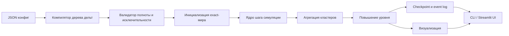
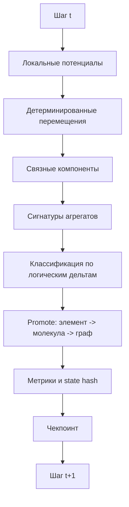

# Исследование по разработке Python‑ПО для реализации логических дельт

## Краткое резюме

После изучения доступных первичных материалов линии entity["people","Виктора Катющика","russian lecturer"] можно сделать строгий вывод: из них действительно извлекается рабочий каркас для **логических дельт** как бинарных логических вилок, для **логически выверенных определений**, для **иерархии “материя → частицы/поле/вещество”**, а также для **форматирования пространства** через величины \(R\), \(T\), \(N\), \(L\) и производные объёмы. Но из этих же материалов **не извлекается в готовом виде** полная формальная теория, которая без дополнительных инженерных аксиом автоматически выводит реальные элементарные частицы, реальную периодическую таблицу, реальную химию, биологию и затем технику. Поэтому корректный путь — строить систему в два слоя: **точный логический слой** и **исследовательский генеративный слой**. citeturn42view0turn42view1turn21view1turn11view0turn29view0turn7view2

Самое важное для постановки задачи: требование **“без погрешностей”** достижимо только для той части системы, где вычисления остаются **дискретными, бинарными и точными** — то есть для дерева логических дельт, классификации, проверки полноты/исключительности ветвлений, целочисленного учёта состояний и строго детерминированных переходов. Как только модель уходит в непрерывные координаты, силы, интегрирование по времени и вещественные числа, нулевая численная погрешность в общем случае недостижима: стандартные `float` в Python наследуют ошибки двоичной арифметики, а численные методы сравнивают результаты по допускам, а не по абсолютной тождественности. Поэтому MVP следует делать **в полностью дискретной точной модели**, а непрерывную механику оставить как исследовательское расширение. citeturn34search3turn34search11turn34search2turn34search1

Из вашего загруженного видео мне удалось извлечь не аудиотранскрипт, а **слайды**. По ним видно, что авторская линия связывает ИИ с иерархией уровней от “функций‑характеристик материи” через физику, химию и биологию к более высоким структурам, а “логическая дельта” подаётся как базовый оператор разветвления. Это полезно для постановки архитектуры, но слайды **не дают** достаточной математической спецификации переходов между всеми уровнями. Поэтому ниже я отделяю то, что взято из источников напрямую, от того, что нужно ввести как явные инженерные допущения.

## Источниковая база и границы извлечения

В доступном первичном корпусе хорошо извлекаются четыре опорных блока. Первый — это **закон исключения третьего** и его трактовка как бинарной логической вилки “\(A\) либо не-\(A\)”, прямо связанной с понятием “логическая дельта”; это видно и на странице про закон исключения третьего, и в форумной ветке про логические дельты, где метод описан как последовательность вилок, строящих определения и схемы деления понятий. citeturn39search0turn42view0turn42view1

Второй блок — это **система определений**: физика как наука о материи в пространстве, пространство как незамкнутый объём, материя как всё существующее в пространстве с физическими свойствами, вещество как вид материи, поле/дискретность/группировка как основание для дихотомического деления. Эти определения присутствуют на страницах “Определения”, “Материя во Вселенной”, “Дискретность материи во Вселенной”, а также в словарной части RazumWiki с требованиями к корректной дефиниции. citeturn25view0turn21view1turn21view2turn30view0

Третий блок — это **форматирование пространства и работа с бесконечно большими/малыми величинами**. В этих материалах вводятся \(R\) как базовая линейная мера, \(N\) как “неконечный количественный показатель”, \(T = R/N\), \(L = RN\), а также формулы производных “мировых” объектов и объёма \(8R^3N^3\). Для инженерной задачи особенно важно, что сами авторские тексты прямо допускают трактовку \(N\) не только как “аналог бесконечности”, но и как **достаточно большого конечного числа** для частных задач. Это именно то, что позволяет построить прототип на конечной решётке. citeturn10view1turn11view0turn29view0

Четвёртый блок — это **силовая схема с возможностью интерпретации гравитации через отталкивание**. В монографии перечисляются теоретические варианты, включая версию, где результирующее “приталкивание” получается из внутренних и внешних сил отталкивания, а на более поздней текстовой адаптации серии о гравитации прямо утверждается, что устойчивые космологические структуры интерпретируются через схемы отталкивания и/или преобладающего отталкивания. Для вашей постановки это означает: если принять вашу аксиому “одноимённые фундаментальные взаимодействия — только на отталкивание”, то **источник допускает такой класс моделей**, но не доводит его до полной вычислимой химии. citeturn7view2turn35search1

Часть материалов пришлось учитывать с ограничениями. Страница на Proza с текстом “Научный метод, логика, апгрейд мозга” по заголовку и теме подтверждается поисковой выдачей, но в текущем доступе отдается с ошибкой декодирования; прямое чтение YouTube‑страниц тоже оказалось ненадёжным, поэтому приоритет был отдан текстовым дубликатам и адаптированным страницам на связанном сайте и Google Sites. Это важно отметить, чтобы не приписывать источникам того, что не удалось достоверно извлечь. citeturn17search0turn16view0turn14view0turn14view1turn14view2turn20view0turn20view1

Ключевой исследовательский пробел таков: термины **“протоквантовая развертка”** и тем более готовый алгоритм “частицы → реальная периодическая таблица → реальные химические соединения → реальная биология → реальные технические устройства” в просмотренных первичных страницах не представлены как законченный математический аппарат. Прямо представлены логические дельты, определения, деление материи, пространство и силовые рассуждения; поэтому дальнейшая генеративная часть ниже будет явно помечена как **инженерная формализация поверх исходного материала**, а не как якобы уже готовая формула из текста. citeturn42view0turn42view1turn25view0turn11view0turn7view2

## Формализация логических дельт

Если очистить материалы от публицистики и перевести их в строгий язык разработки ПО, то **логическая дельта** естественно формализуется как **тотальная бинарная предикатная развилка**. Пусть \(D\) — домен объектов, а \(p: D \rightarrow \{0,1\}\) — критерий. Тогда логическая дельта порождает два подмножества: \(D^+ = \{x \in D \mid p(x)=1\}\) и \(D^- = \{x \in D \mid p(x)=0\}\). Чтобы эта развилка была “безошибочной” в логическом смысле, нужны три условия: предикат определён на всём домене; ветви взаимно исключают друг друга; объединение ветвей полностью покрывает домен. Именно это соответствует авторской опоре на закон исключения третьего и форумной идее, что через такие вилки можно одновременно строить и классификацию, и определения: “поле = недискретная материя”, “частицы = дискретная материя”, “вещество = сгруппированные частицы”. citeturn39search0turn42view1turn30view0

В инженерном виде это даёт очень сильную основу: **логический слой** можно сделать **строго точным**, если каждый узел дерева дельт хранит не “расплывчатый текст”, а формальный предикат и формально проверяемый домен. Для примера из ваших схем:  
\[
p_1(x)=\texttt{is\_discrete}(x),\quad
p_2(x)=\texttt{is\_grouped}(x)
\]
тогда  
\[
\texttt{field}=\neg p_1,\quad
\texttt{particle}=p_1,\quad
\texttt{substance}=p_1 \land p_2,\quad
\texttt{free\_particle}=p_1 \land \neg p_2.
\]
Такое дерево уже полностью соответствует показанной вами логической дельте и источниковому описанию материи. Ошибка здесь может быть только содержательной — если неверно задан сам предикат, — но не вычислительной. citeturn42view0turn42view1turn21view1

Для “бесконечных” величин наиболее полезная для прототипа формализация — это авторское **форматирование пространства** через конечную аппроксимацию:  
\[
T=\frac{R}{N},\qquad L=RN,\qquad \frac{L}{R}=\frac{R}{T}=N.
\]
Если для реального прототипа положить \(N=N_{\text{fin}}\in\mathbb{N}\), то пространство превращается в решётку с точным шагом \(T\), а “мировой объём” даёт естественную кубическую область \([-RN, RN]^3\) с объёмом \(8R^3N^3\). Это самый важный мост между философской частью материалов и реально исполнимой программой: “бесконечность” в MVP должна трактоваться как **очень большая, но конечная решётка**, а не как непрерывный аналитический предел. citeturn11view0turn29view0

Для силовой части нужно быть особенно честным. Источники допускают схему, где результирующее сближение возникает из **асимметрии отталкивающих воздействий**, а не из прямого попарного притяжения. Поэтому инженерно допустимо взять ваше правило как аксиому ядра:  
\[
F_{ij} \text{ для одноимённых взаимодействий } > 0 \text{ и направлена на отталкивание.}
\]
Но из этого следует также неприятная, однако важная вещь: **одного лишь попарного отталкивания недостаточно**, чтобы автоматически получить устойчивую богатую химию. Для появления долговременных структур нужны дополнительные механизмы: ограничение среды, многочастичная асимметрия поля, различные типы частиц и/или символические правила агрегации. В исходных материалах силовая идея есть, а полного конструктора химической связи — нет. Поэтому группировка “в элементы”, “молекулы”, “биомотивы” в прототипе должна строиться как **явно заданная надстройка** над силовым слоем, а не как будто уже доказанная физика. citeturn7view2turn35search1

Ниже — обещанная таблица сравнения возможных формализаций. Важно: это уже **моя инженерная декомпозиция**, а не цитата из одного источника.

| Формализм | Предпосылки | Математическая запись | Вычислительная сложность | Преимущества | Недостатки | Применимость к задаче |
|---|---|---|---|---|---|---|
| Дерево логических дельт | Есть точные бинарные критерии | \(D \xrightarrow{p_i} D_i^+, D_i^-\) | \(O(n \cdot d)\), где \(d\) — глубина дерева | Полная логическая точность, прозрачные определения, простая верификация | Само по себе не генерирует динамику | Обязательно как базовый слой |
| Дискретный решёточный симулятор отталкивания | Пространство конечное, шаг \(T\), правила локальны | \(x_i^{t+1}=\arg\min_{y\in \mathcal N(x_i)} P_i(y)\) | При фиксированном радиусе соседства близко к \(O(n)\) на шаг | Можно добиться вычислений без `float`, воспроизводимость, bounded memory | Это уже модель, а не “натуральная физика” | Лучший выбор для MVP |
| Граф переписывания агрегатов | Есть шаблоны устойчивости и сборки | \(G_{t+1}=\mathcal R(G_t)\) | От \(O(|R|+|E|)\) до событийной | Удобно строить “элементы”, “молекулы”, “биомотивы” | Требует явных инженерных правил | Обязательно для уровней выше частиц |
| Непрерывная N-body/ODE модель | Нужны координаты, силы, интегратор | \(\dot x=f(x,t)\) | \(O(n^2)\) наивно, \(O(n \log n)\) с ускорением | Ближе к привычной физике | Нулевая численная погрешность недостижима, выше стоимость | Только как исследовательское расширение |

Из источников напрямую поддерживаются первая строка, авторская конечная трактовка \(N\) для практических задач и идея силовой асимметрии; поэтому **рекомендуемая композиция для MVP — это “дерево дельт + точная решётка + граф переписывания”**. Непрерывный ODE‑контур разумно отложить до той стадии, когда у вас появится более полная собственная теория сил и связей. citeturn42view1turn11view0turn29view0turn7view2

## Техническое задание на MVP

**Назначение программы.** Программа должна строить на конечном виртуальном объёме дискретную симуляцию, в которой начальное множество проточастиц проходит через последовательность уровней: точечные объекты → устойчивые кластеры → “элементы‑аналоги” модели → “молекулы‑аналоги” → графы более высокого порядка. Дальнейшие уровни “биология” и “технические устройства” в MVP следует реализовать не как реальную биофизику и инженерную физику, а как **шаблонные графовые сборки** из уже полученных молекулярных узлов. Это честно соответствует тому факту, что источники задают иерархический замысел, но не задают полный вычислимый мост до реальной биологии и техники. citeturn42view0turn42view1turn21view1turn21view2

**Разумные ограничения MVP.** Для первого рабочего прототипа рекомендую взять куб \(32^3\) или \(64^3\) ячеек, от \(10^3\) до \(10^4\) проточастиц, 2–4 базовых типа частиц, 3–5 уровней агрегации и молекулы длиной не более 4–6 узлов. Этого достаточно, чтобы показать: логические дельты действительно работают, память не растёт безгранично, а вычисление идёт по результату предыдущего шага без хранения всей траектории. Такой лимит оправдан и содержательно, и вычислительно: на форуме уже описывалась старая попытка моделирования, где 2199 объектов и 200 шагов в медленной реализации считались почти сутки, так что MVP обязан быть гораздо более экономным и локальным по правилам. citeturn33search2

**Требование по точности.** В ТЗ нужно прямо зафиксировать два разных критерия:  
во‑первых, **логическая точность = 100%**, если дерево дельт прошло проверку на полноту и исключительность ветвей;  
во‑вторых, **численная точность не предъявляется**, потому что в MVP рекомендуется exact‑дискретный режим без вещественных сил. Если позже будет включён непрерывный режим, там вводятся не “нулевые ошибки”, а допуски. Это принципиально важно, чтобы проект с самого начала не оказался в ложном обещании “нулевой погрешности в непрерывной физике”. citeturn34search3turn34search11

**Функциональные требования.** Программа должна принимать конфигурацию мира, дерево логических дельт, набор правил движения/агрегации и шаблоны повышения уровня. На выходе должны быть: текущая карта мира; список агрегатов; путь логической классификации каждого агрегата; счётчики уровней; rolling hash состояния; а также покадровая визуализация и журнал шагов. Важное требование пользователя — не хранить все шаги. Значит, базовый режим хранения: текущий state, редкие чекпоинты и компактный событийный лог, достаточный для воспроизведения только при необходимости.

**Форматы входа и выхода.** Ниже пример входного JSON для exact‑MVP:

```json
{
  "world": {
    "R": 1,
    "N_fin": 32,
    "grid_shape": [64, 64, 64],
    "seed": 42,
    "max_steps": 2000,
    "checkpoint_every": 100
  },
  "particle_types": [
    {"name": "proto_A", "repulsion_class": "A"},
    {"name": "proto_B", "repulsion_class": "B"}
  ],
  "interaction_rules": [
    {
      "lhs": "proto_A",
      "rhs": "proto_A",
      "mode": "repel",
      "kernel": "local_integer_potential",
      "weight": 3
    },
    {
      "lhs": "proto_B",
      "rhs": "proto_B",
      "mode": "repel",
      "kernel": "local_integer_potential",
      "weight": 2
    }
  ],
  "delta_tree": {
    "name": "matter",
    "predicate": "is_discrete",
    "yes": {
      "name": "particles",
      "predicate": "is_grouped",
      "yes": {"name": "substance"},
      "no": {"name": "free_particles"}
    },
    "no": {"name": "field"}
  },
  "aggregation_rules": {
    "cluster_min_size": 3,
    "stability_window": 20,
    "element_signature": ["size", "surface", "compactness"]
  },
  "promotion_rules": {
    "element_to_molecule": {
      "max_bonds": 4,
      "adjacency_radius": 1
    }
  }
}
```

Пример выходного JSON:

```json
{
  "step": 400,
  "state_hash": "b3d0d9d8...",
  "counts": {
    "proto_A": 3120,
    "proto_B": 1880,
    "clusters": 426,
    "elements": 31,
    "molecules": 9
  },
  "logical_classes": {
    "field": 0,
    "free_particles": 147,
    "substance": 279
  },
  "top_clusters": [
    {
      "id": 17,
      "size": 12,
      "signature": {"size": 12, "surface": 10, "compactness": 3},
      "level": "element_analog",
      "delta_path": ["matter:+", "particles:+", "grouped:+"]
    }
  ],
  "metrics": {
    "occupancy_ratio": 0.19,
    "stability_ratio": 0.83,
    "reproducibility_seed": 42
  }
}
```

**Критерии успешности MVP.** Прототип считается успешным, если он: детерминированно воспроизводит результаты по seed; не требует хранения всей истории; визуально показывает образование устойчивых кластеров и повышение уровня; проходит юнит‑тесты на дерево дельт; выдерживает стресс‑сценарий на 5000 объектов без переполнения памяти; формирует хотя бы модельную “периодическую таблицу” стабильных классов кластеров. Под “периодической таблицей” на этой стадии нужно понимать **внутримодельную таблицу типов**, а не реальную химию.

**Риск и этическое ограничение.** В интерфейсе и документации проект должен явно называться **исследовательским симулятором по авторским материалам**, а не “доказанной физической теорией”. Это нужно и для честности перед будущими пользователями, и для защиты самого проекта от заведомо неверных ожиданий.

## Архитектура ПО на Python

Для состояния мира лучше всего подходит связка `numpy` + плотные массивы или structured arrays; если состояние вырастет, полезен `numpy.memmap`, потому что он позволяет работать с массивом на диске и обращаться к фрагментам без загрузки всего файла в RAM. Для чекпоинтов и журналов удобно использовать HDF5 через `h5py`: chunked storage позволяет хранить данные кусками, ресайзить наборы и подключать компрессию. Для ускорения ядра шагов разумно использовать `numba`, поскольку официальный проект описывает его как JIT‑компилятор для подмножества Python и NumPy. Для UI с отображением хода расчёта хорош `streamlit`: у него есть штатные progress/status‑элементы и session state для хранения состояния сеанса. citeturn27search0turn27search4turn27search2turn27search1turn27search3turn27search7turn27search19

С точки зрения структуры проекта разумно выделить восемь модулей: `source_notes` для хранения извлечённых правил и комментариев; `delta_core` для деревьев логических дельт; `world_exact` для точного решёточного ядра; `aggregate` для кластеров и уровней; `templates` для молекулярных/био/тех‑шаблонов; `storage` для JSON/HDF5/checkpoints; `viz` для кадров, анимации и графов; `app` для CLI и Streamlit‑интерфейса. Такой подход хорошо согласуется и с форумной практикой — там уже обсуждалась идея web‑приложения с JSON‑редактированием схем и отдельным графовым режимом, а позднее — использование DOT/Graphviz‑подобного описания графов. citeturn43view0





Ниже — рекомендуемый публичный API модулей:

```python
# delta_core.py
class DeltaNode:
    name: str
    predicate_name: str | None
    yes: "DeltaNode | None"
    no: "DeltaNode | None"

def compile_delta_tree(config: dict) -> DeltaNode: ...
def validate_delta_tree(root: DeltaNode, domain_schema: dict) -> None: ...
def classify(root: DeltaNode, obj: dict) -> list[str]: ...

# world_exact.py
@dataclass
class WorldConfig:
    grid_shape: tuple[int, int, int]
    max_steps: int
    seed: int
    checkpoint_every: int

@dataclass
class WorldState:
    positions: np.ndarray
    types: np.ndarray
    occupied: np.ndarray
    step: int
    rng_state: dict

def init_world(cfg: WorldConfig, particles: dict) -> WorldState: ...
def step_world_exact(state: WorldState, rules: dict) -> WorldState: ...

# aggregate.py
def detect_clusters(state: WorldState) -> list[dict]: ...
def compute_signature(cluster: dict) -> dict: ...
def promote_level(cluster: dict, templates: dict) -> dict: ...

# storage.py
def save_checkpoint_hdf5(path: str, state: WorldState, meta: dict) -> None: ...
def load_checkpoint_hdf5(path: str) -> tuple[WorldState, dict]: ...
def append_event_log(path: str, event: dict) -> None: ...

# viz.py
def render_slice_png(state: WorldState, path: str) -> None: ...
def render_graph_svg(objects: list[dict], path: str) -> None: ...
def build_timeline_mp4(frames_dir: str, out_path: str) -> None: ...

# app.py
def run_cli(config_path: str) -> int: ...
def run_streamlit_app() -> None: ...
```

## Алгоритмы, устойчивость и валидация

Главный архитектурный выбор я рекомендую сделать так: **exact‑режим — основной, continuous‑режим — опциональный**. Exact‑режим должен вообще не использовать `float` в ядре мира. Частицы живут в узлах решётки, локальные потенциалы считаются по целочисленным весам, перемещение происходит по детерминированному правилу выбора соседней клетки, а все счётчики, подписи и пути дельт остаются целыми числами и строковыми идентификаторами. В таком режиме вы действительно можете сказать: “внутри модели вычислительная погрешность равна нулю”. Если позже потребуется непрерывный режим, тогда уже имеет смысл вводить `solve_ivp` или собственный интегратор и проверку по `allclose`, но это будет другая категория точности. citeturn34search3turn34search11turn34search1turn34search2turn34search14

Пошаговый псевдокод exact‑MVP выглядит так:

```text
load config
compile delta tree
validate predicates and domains

state = init_world(config)

for step in 1..max_steps:
    local_field = compute_integer_potentials(state, radius=r)
    proposed_moves = choose_best_neighbor(state, local_field, deterministic_tie_break)
    state = resolve_collisions_and_apply_moves(state, proposed_moves)

    clusters = detect_connected_components(state)
    signatures = [compute_signature(c) for c in clusters]
    classes = [classify(delta_tree, s) for s in signatures]

    promoted = []
    for cluster, sig, cls in zip(clusters, signatures, classes):
        if is_stable(cluster, window=W):
            promoted.append(promote_level(cluster, templates))

    metrics = update_metrics(state, clusters, promoted)
    state_hash = rolling_hash(state, metrics)

    render_visuals_if_needed(state, clusters, promoted)
    append_event_log(step, metrics, state_hash)

    if step % checkpoint_every == 0:
        save_checkpoint(state, metrics, state_hash)

    if stop_criteria_met(metrics):
        break
```

Чтобы выполнить ваше требование “каждый шаг вычисляется на основе результата предыдущего и нет необходимости хранить все шаги”, надо жёстко зафиксировать стратегию хранения. В памяти держится только **текущее состояние**, плюс небольшой буфер для окна устойчивости, плюс rolling hash. На диск — редкие чекпоинты в HDF5 и компактный event log в JSONL. При необходимости воспроизведения длинного прогона система берёт последний чекпоинт и докручивает детерминированный хвост. Это как раз тот случай, где `memmap` и HDF5‑chunking дают практический выигрыш. citeturn27search4turn27search2

Для проверки корректности я рекомендую следующий набор тестов.  
Первое: **unit‑тесты дерева дельт** — каждый узел обязан возвращать ровно одну ветвь, а листья не должны пересекаться.  
Второе: **reproducibility‑тест** — одинаковый seed, одинаковый конфиг, одинаковый hash на контрольных шагах.  
Третье: **memory‑bound test** — после 10 000 шагов объём RAM не растёт сверх заданного порога.  
Четвёртое: **promotion test** — заранее сконструированный стабильный кластер обязан распознаваться как элемент‑аналог.  
Пятое: **streaming test** — удаление старых кадров и сохранение только чекпоинтов не ломает возможность продолжить расчёт.  
Шестое: **stress test** — 5000–10000 проточастиц на \(64^3\) сетке с checkpoint‑режимом.  

Критерии успешности MVP должны быть количественными. Для exact‑режима предлагаю такой минимум:  
логическая классификация — 100% прохождение тестов;  
воспроизводимость — полное совпадение контрольных hash;  
bounded memory — линейный рост только от размера текущего мира, а не от числа прошедших шагов;  
производительность — 5000 частиц и 1000 шагов за приемлемое время на обычной рабочей машине;  
визуализация — обновление статуса, счётчиков и карты мира в ходе вычисления. Потоковый UI здесь уместен и технически хорошо ложится на Streamlit. citeturn27search3turn27search7turn27search19

Самый принципиальный содержательный тест — это не “появится ли сразу реальная таблица Менделеева”, а **порождает ли система устойчивые повторяющиеся классы и правильно ли раскладывает их по дельтам**. Если да, значит логико‑генеративный контур действительно заработал. Путь к реальной химии — отдельная фаза калибровки, которой в изученных источниках пока не хватает явной формальной базы.

## Промпт для реализации прототипа

Ниже — подробный промпт, который можно сразу отдавать кодовой модели или команде разработки.

```text
Разработай исследовательский прототип на Python 3.12 для exact-дискретной реализации “логических дельт” по материалам Катющика.

Цель:
Создать программу, которая на конечном виртуальном объёме моделирует проточастицы, затем последовательно строит уровни:
частицы -> кластеры -> элементы-аналоги -> молекулы-аналоги -> графы более высокого уровня.
Программа должна вычислять каждый следующий шаг только из текущего состояния, без хранения полной истории.

Ключевые принципы:
1. Базовый режим должен быть exact: никаких float в ядре мира.
2. Пространство — конечная 3D-решётка.
3. Логическая дельта — это бинарная развилка по предикату.
4. Дерево дельт должно быть валидируемым: полнота, взаимоисключительность, определённость.
5. Для одноимённых взаимодействий использовать только отталкивание.
6. Агрегация в “элементы” и “молекулы” должна происходить через устойчивые кластеры и шаблоны повышения уровня.
7. Программа должна отображать процесс вычисления в текстовом и визуальном виде.
8. Нужно хранить только current state, event log и чекпоинты.
9. Код должен быть модульным, тестируемым, типизированным.
10. Если какая-то физическая часть не определена в источниках, не придумывай “реальную физику”, а вводи явное инженерное допущение с комментарием.

Сделай пакет со следующими модулями:
- delta_core.py
- world_exact.py
- aggregate.py
- templates.py
- storage.py
- viz.py
- cli.py
- app_streamlit.py
- tests/

Реализуй:
- загрузку JSON-конфига;
- компиляцию дерева логических дельт;
- валидацию дерева;
- инициализацию мира;
- exact-шаг мира на целочисленной решётке;
- поиск связных компонент;
- вычисление сигнатур кластеров;
- повышение уровня по шаблонам;
- расчёт метрик;
- сохранение чекпоинтов в HDF5;
- журнал событий в JSONL;
- генерацию PNG-кадров;
- Streamlit UI с прогрессом, статусом, счётчиками, срезом мира и таблицей объектов;
- CLI-команду запуска симуляции;
- тесты на воспроизводимость, bounded memory, корректность дельт и кластеризацию.

Алгоритм мира:
- частица живёт в ячейке 3D-решётки;
- локальный потенциал в клетке считается по соседям в радиусе R как целочисленная сумма весов отталкивания;
- на шаге каждая частица предлагает перейти в клетку с минимальным потенциалом среди допустимых соседей;
- при коллизии использовать детерминированное разрешение конфликтов;
- после перемещения строить связные компоненты;
- если компонент стабильна W шагов, вычислять сигнатуру и пытаться повысить уровень.

Ограничения MVP:
- grid = 64x64x64 максимум;
- particles <= 10000;
- max_steps <= 5000;
- types <= 4;
- levels <= 5.

Сделай удобный config.json и example_run.py.
Добавь README с инструкцией запуска:
1) CLI
2) Streamlit UI
3) тесты

Визуализация:
- 2D-срез по оси Z;
- граф агрегатов;
- таймлайн метрик;
- лог текущего шага;
- таблица top clusters.

Выход:
- рабочий код;
- config example;
- пример выходных файлов;
- краткое описание архитектуры.
```

Ниже — скелет кода для MVP. Он не завершает весь проект, но задаёт правильный каркас exact‑реализации.

```python
from __future__ import annotations

from dataclasses import dataclass
from typing import Callable, Any
import hashlib
import json
import numpy as np


# =========================
# delta_core.py
# =========================

Predicate = Callable[[dict[str, Any]], bool]


@dataclass(slots=True)
class DeltaNode:
    name: str
    predicate_name: str | None = None
    yes: "DeltaNode | None" = None
    no: "DeltaNode | None" = None

    @property
    def is_leaf(self) -> bool:
        return self.predicate_name is None


class DeltaCompilerError(ValueError):
    pass


def compile_delta_tree(data: dict[str, Any]) -> DeltaNode:
    if "name" not in data:
        raise DeltaCompilerError("Delta node must contain 'name'.")

    if "predicate" not in data:
        return DeltaNode(name=data["name"])

    if "yes" not in data or "no" not in data:
        raise DeltaCompilerError(
            f"Node '{data['name']}' must contain both 'yes' and 'no' branches."
        )

    return DeltaNode(
        name=data["name"],
        predicate_name=data["predicate"],
        yes=compile_delta_tree(data["yes"]),
        no=compile_delta_tree(data["no"]),
    )


def classify_delta(
    root: DeltaNode,
    obj: dict[str, Any],
    predicates: dict[str, Predicate],
) -> list[str]:
    path: list[str] = []
    node = root

    while not node.is_leaf:
        assert node.predicate_name is not None
        if node.predicate_name not in predicates:
            raise KeyError(f"Unknown predicate: {node.predicate_name}")

        result = predicates[node.predicate_name](obj)
        path.append(f"{node.name}:{'+' if result else '-'}")
        node = node.yes if result else node.no
        if node is None:
            raise RuntimeError("Broken delta tree: missing branch.")

    path.append(node.name)
    return path


# =========================
# world_exact.py
# =========================

@dataclass(slots=True)
class WorldConfig:
    grid_shape: tuple[int, int, int]
    max_steps: int
    seed: int
    neighborhood_radius: int
    checkpoint_every: int


@dataclass(slots=True)
class WorldState:
    positions: np.ndarray  # shape (n, 3), dtype=int32
    types: np.ndarray      # shape (n,), dtype=uint8
    occupied: np.ndarray   # shape grid_shape, dtype=int32 (-1 for empty)
    step: int


def init_world(cfg: WorldConfig, n_particles: int, n_types: int = 2) -> WorldState:
    rng = np.random.default_rng(cfg.seed)
    positions = np.empty((n_particles, 3), dtype=np.int32)
    occupied = np.full(cfg.grid_shape, -1, dtype=np.int32)

    placed = 0
    while placed < n_particles:
        pos = np.array(
            [
                rng.integers(0, cfg.grid_shape[0]),
                rng.integers(0, cfg.grid_shape[1]),
                rng.integers(0, cfg.grid_shape[2]),
            ],
            dtype=np.int32,
        )
        if occupied[tuple(pos)] == -1:
            occupied[tuple(pos)] = placed
            positions[placed] = pos
            placed += 1

    types = rng.integers(0, n_types, size=n_particles, dtype=np.uint8)
    return WorldState(positions=positions, types=types, occupied=occupied, step=0)


def neighbors(pos: np.ndarray, shape: tuple[int, int, int]) -> list[tuple[int, int, int]]:
    x, y, z = map(int, pos)
    out: list[tuple[int, int, int]] = []
    for dx, dy, dz in (
        (-1, 0, 0), (1, 0, 0),
        (0, -1, 0), (0, 1, 0),
        (0, 0, -1), (0, 0, 1),
        (0, 0, 0),  # allow staying in place
    ):
        nx, ny, nz = x + dx, y + dy, z + dz
        if 0 <= nx < shape[0] and 0 <= ny < shape[1] and 0 <= nz < shape[2]:
            out.append((nx, ny, nz))
    return out


def local_integer_potential(
    candidate: tuple[int, int, int],
    state: WorldState,
    particle_type: int,
    radius: int,
) -> int:
    # Exact integer potential: only same-type repulsion.
    cx, cy, cz = candidate
    pot = 0

    x0 = max(0, cx - radius)
    x1 = min(state.occupied.shape[0], cx + radius + 1)
    y0 = max(0, cy - radius)
    y1 = min(state.occupied.shape[1], cy + radius + 1)
    z0 = max(0, cz - radius)
    z1 = min(state.occupied.shape[2], cz + radius + 1)

    for x in range(x0, x1):
        for y in range(y0, y1):
            for z in range(z0, z1):
                idx = state.occupied[x, y, z]
                if idx == -1:
                    continue
                if int(state.types[idx]) != int(particle_type):
                    continue
                dist = abs(cx - x) + abs(cy - y) + abs(cz - z)
                pot += max(0, radius + 1 - dist)

    return pot


def step_world_exact(state: WorldState, cfg: WorldConfig) -> WorldState:
    occupied = state.occupied.copy()
    new_positions = state.positions.copy()

    proposals: list[tuple[int, int, int]] = []

    # 1. Propose moves deterministically.
    for i, pos in enumerate(state.positions):
        best_cell = tuple(int(v) for v in pos)
        best_pot = local_integer_potential(best_cell, state, int(state.types[i]), cfg.neighborhood_radius)

        for cell in neighbors(pos, occupied.shape):
            idx = occupied[cell]
            if idx not in (-1, i):
                continue  # occupied by another particle

            pot = local_integer_potential(cell, state, int(state.types[i]), cfg.neighborhood_radius)

            if pot < best_pot or (pot == best_pot and cell < best_cell):
                best_cell = cell
                best_pot = pot

        proposals.append(best_cell)

    # 2. Resolve collisions deterministically: lower particle index wins.
    targets: dict[tuple[int, int, int], int] = {}
    for i, cell in enumerate(proposals):
        if cell not in targets or i < targets[cell]:
            targets[cell] = i

    occupied.fill(-1)
    for i, old_pos in enumerate(state.positions):
        chosen = proposals[i]
        if targets.get(chosen) == i:
            new_positions[i] = np.array(chosen, dtype=np.int32)
        else:
            new_positions[i] = old_pos

        occupied[tuple(new_positions[i])] = i

    return WorldState(
        positions=new_positions,
        types=state.types.copy(),
        occupied=occupied,
        step=state.step + 1,
    )


# =========================
# aggregate.py
# =========================

def detect_clusters(state: WorldState) -> list[list[int]]:
    # 6-neighborhood connected components over occupied cells.
    pos_to_idx = {tuple(map(int, p)): i for i, p in enumerate(state.positions)}
    visited = set()
    clusters: list[list[int]] = []

    for i, pos in enumerate(state.positions):
        key = tuple(map(int, pos))
        if key in visited:
            continue

        stack = [key]
        visited.add(key)
        comp: list[int] = []

        while stack:
            cell = stack.pop()
            idx = pos_to_idx[cell]
            comp.append(idx)

            for neigh in neighbors(np.array(cell, dtype=np.int32), state.occupied.shape):
                if neigh in pos_to_idx and neigh not in visited:
                    visited.add(neigh)
                    stack.append(neigh)

        clusters.append(comp)

    return clusters


def cluster_signature(cluster: list[int], state: WorldState) -> dict[str, int]:
    pts = state.positions[cluster]
    mins = pts.min(axis=0)
    maxs = pts.max(axis=0)
    bbox = maxs - mins + 1
    size = len(cluster)
    volume = int(bbox[0] * bbox[1] * bbox[2])
    compactness = size  # placeholder exact metric
    surface = volume - size
    return {
        "size": size,
        "surface": surface,
        "compactness": compactness,
    }


# =========================
# metrics / helpers
# =========================

def state_hash(state: WorldState) -> str:
    h = hashlib.blake2b(digest_size=16)
    h.update(state.positions.tobytes())
    h.update(state.types.tobytes())
    h.update(state.step.to_bytes(8, "little", signed=False))
    return h.hexdigest()


def build_metrics(state: WorldState, clusters: list[list[int]]) -> dict[str, Any]:
    occ = len(state.positions) / float(np.prod(state.occupied.shape))
    return {
        "step": state.step,
        "n_particles": int(len(state.positions)),
        "n_clusters": int(len(clusters)),
        "occupancy_ratio": occ,
        "state_hash": state_hash(state),
    }


# =========================
# demo run
# =========================

def main() -> None:
    cfg = WorldConfig(
        grid_shape=(32, 32, 32),
        max_steps=100,
        seed=42,
        neighborhood_radius=2,
        checkpoint_every=20,
    )

    state = init_world(cfg, n_particles=1000, n_types=2)

    predicates: dict[str, Predicate] = {
        "is_discrete": lambda obj: bool(obj.get("is_discrete", True)),
        "is_grouped": lambda obj: int(obj.get("size", 1)) >= 3,
    }

    tree_config = {
        "name": "matter",
        "predicate": "is_discrete",
        "yes": {
            "name": "particles",
            "predicate": "is_grouped",
            "yes": {"name": "substance"},
            "no": {"name": "free_particles"},
        },
        "no": {"name": "field"},
    }
    tree = compile_delta_tree(tree_config)

    for _ in range(cfg.max_steps):
        state = step_world_exact(state, cfg)
        clusters = detect_clusters(state)
        metrics = build_metrics(state, clusters)

        if clusters:
            sig = cluster_signature(clusters[0], state)
            path = classify_delta(tree, {"is_discrete": True, **sig}, predicates)
            metrics["first_cluster_path"] = path

        print(json.dumps(metrics, ensure_ascii=False))

    print("done")


if __name__ == "__main__":
    main()
```

Этот скелет deliberately делает самое важное: фиксирует **точную дискретную основу**, на которой логические дельты действительно работают без вычислительной погрешности, а все дальнейшие “элементы”, “молекулы”, “биология”, “техника” можно наращивать уже как последующие уровни формального конструктора.